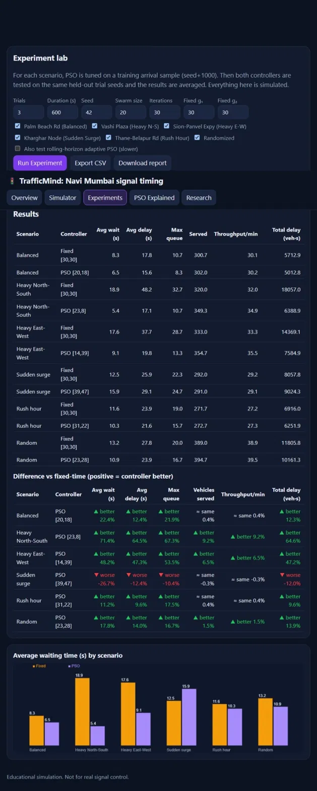
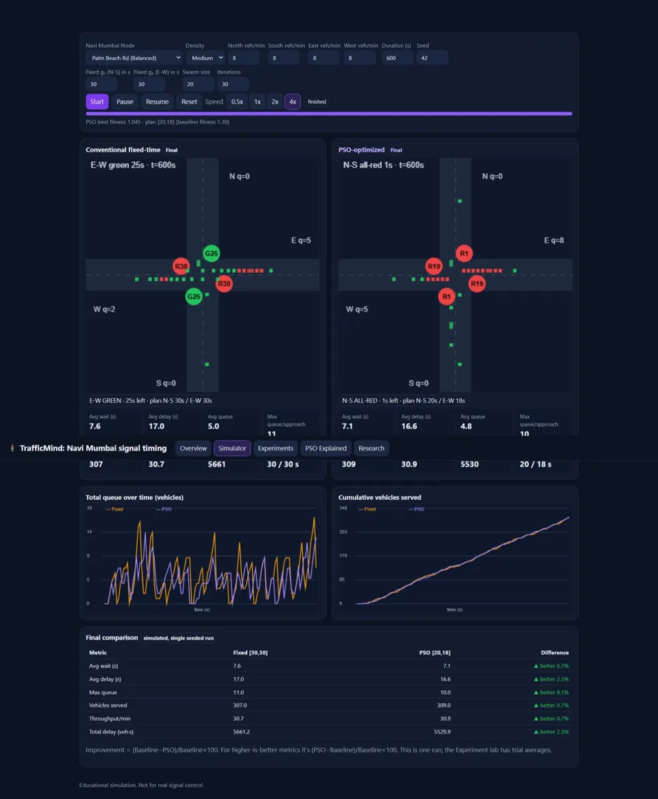
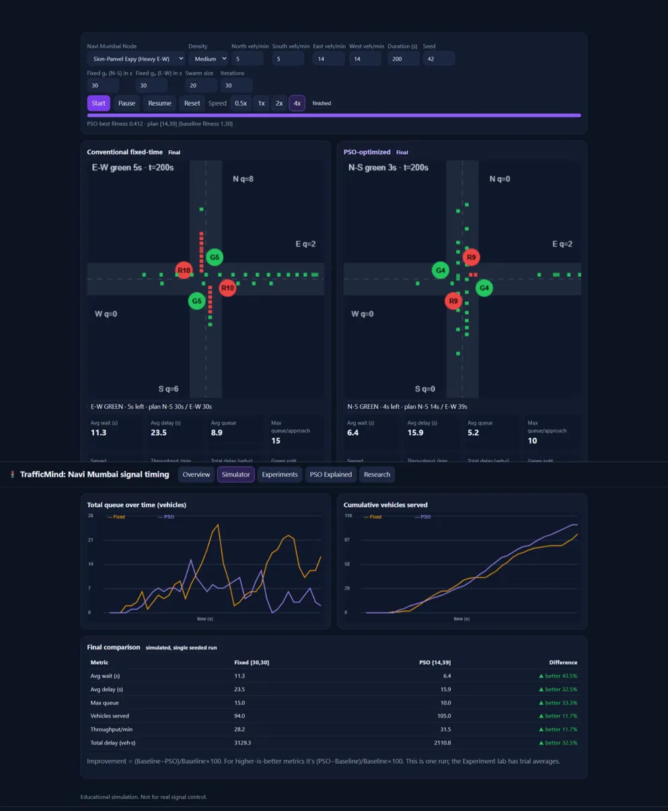

# 🚦 TrafficMind: Bio-Inspired Traffic Signal Optimizer

> Can a swarm of "birds" beat a fixed-time traffic light? TrafficMind is a browser-based microscopic traffic simulator that uses **Particle Swarm Optimization (PSO)** to tune signal timings for simulated Navi Mumbai junctions.

**🔗 Live demo: https://bio-inspired-traffic-pso.vercel.app/**

> \[!NOTE\]
> The junction names (Vashi Plaza, Sion-Panvel Expressway, etc.) are labels for demand patterns. The traffic volumes are **invented**, not surveyed. This is an educational simulation, not a tool for real signal control.

## Table of Contents

 1. [About the Project](#about-the-project)

 2. [Key Features](#key-features)

 3. [Screenshots](#screenshots)

 4. [How It Works](#how-it-works)

 5. [Scenarios](#scenarios)

 6. [Using the App](#using-the-app)

 7. [Sample Results](#sample-results)

 8. [PSO: Pros and Cons](#pso-pros-and-cons)

 9. [Why PSO Here, and What Else Could Work](#why-pso-here-and-what-else-could-work)

10. [Parameters](#parameters)

11. [Limitations](#limitations)

12. [Future Work](#future-work)

13. [Tech Stack and Project Structure](#tech-stack-and-project-structure)

14. [Run Locally and Deploy](#run-locally-and-deploy)

15. [References](#references)

16. [Acknowledgements](#acknowledgements)

17. [License and Author](#license-and-author)

## About the Project

Fixed-time traffic signals give each road a preset green time, whatever the traffic looks like. That is simple and predictable, but it wastes green on a quiet road while a busy one builds a queue.

TrafficMind asks one question: **can a bio-inspired optimizer find better green-time splits than a fixed plan?** It was built as a Semester 1 college project on **biomimicry in computer engineering**. PSO is inspired by how bird flocks and fish schools share information while searching for food.

The project has two parts:

1. A **vehicle-by-vehicle traffic simulator**, realistic enough to measure delay and queues.

2. A **Particle Swarm Optimizer** that scores each candidate timing plan by *running that simulator*, so the fitness is measured, not guessed.

## Key Features

* **Microscopic simulation:** vehicles follow the Intelligent Driver Model (IDM) for acceleration, braking and queueing, with seeded Poisson arrivals, so every run is reproducible.

* **Side-by-side comparison:** a conventional fixed-time controller and a PSO-optimized controller run on the *identical* vehicle list, with live queue and throughput charts.

* **Honest evaluation:** PSO is tuned on a separate training arrival sample (`seed + 1000`), then both controllers are tested on held-out trial seeds, so PSO cannot simply memorize the test traffic.

* **Experiment Lab:** run all scenarios over several trials, see the improvement over fixed-time, and export a **CSV** and a **Markdown report**.

* **PSO visualizer:** watch particles move through the `(g₁, g₂)` search space while fitness improves per iteration.

* **Optional adaptive mode:** a rolling-horizon PSO that re-optimizes at cycle boundaries from recently observed arrivals.

* **Custom setups:** set your own arrival rates, density, duration, seed, fixed timings, swarm size and iteration count.

* **Zero dependencies:** one HTML file with plain JavaScript and Canvas. No build step, no libraries, no server.

* **Accessible interface:** semantic HTML, labelled inputs, keyboard focus styles, and ARIA labels on charts and progress bars.

## Screenshots

**Experiment Lab results (all six scenarios, 3 held-out trials):**


**Live simulator run (Balanced / Palm Beach Rd):**


**Live simulation run (Sion-Panvel Expy - Heavy E-W):**



### Reading the simulator screen

* Each coloured circle at the junction is a signal. The letter is its colour (**G**reen, **Y**ellow, **R**ed) and the number is a countdown in seconds.

* Small squares are vehicles: **green** means moving, **red** means stopped (below 0.5 m/s).

* `N q=4` is the number of vehicles queued on the north approach, and so on for S, E and W.

* The pill under each junction shows the active phase, the time left, and that controller's green plan.

## How It Works

```
flowchart LR
    A["Scenario + seed"] --> B["Training arrivals<br/>(seed + 1000)"]
    B --> C["Swarm of candidate plans<br/>[g1, g2]"]
    C --> D["Simulate each plan<br/>and compute fitness J"]
    D --> E{"All iterations<br/>done?"}
    E -- "No" --> F["Update velocity and position,<br/>repair to valid greens"]
    F --> C
    E -- "Yes" --> G["Best plan"]
    G --> H["Test against fixed-time on<br/>identical held-out arrivals"]
    H --> I["Metrics, charts,<br/>CSV and report"]

```

### 1. The traffic simulator

A four-approach junction (North, South, East, West) with one lane per approach and two signal phases: North-South, then East-West.

| Component | Model | 
| ----- | ----- | 
| Arrivals | Poisson process per approach (generated by thinning), in vehicles/min; 90% cars (4.5 m), 10% long vehicles (9 m) | 
| Car-following | Intelligent Driver Model: free speed 13.9 m/s (about 50 km/h), max acceleration 2.5 m/s², comfortable braking 3.5 m/s², minimum gap 2 m, time headway 1.2 s | 
| Geometry | 150 m approach, 14 m junction box, 100 m exit | 
| Signal cycle | Green, then 3 s amber, then 2 s all-red, for each phase | 
| Time step | 0.1 s | 
| Randomness | Seeded generator, so results are exactly repeatable | 

```
stateDiagram-v2
    [*] --> NS_Green
    NS_Green --> NS_Amber: g1 seconds
    NS_Amber --> NS_AllRed: 3 s
    NS_AllRed --> EW_Green: 2 s
    EW_Green --> EW_Amber: g2 seconds
    EW_Amber --> EW_AllRed: 3 s
    EW_AllRed --> NS_Green: 2 s

```

The full cycle length is `g₁ + g₂ + 10 s`. With the default 30 s / 30 s plan, that is 70 s.

### 2. The Particle Swarm Optimizer

Each **particle** is a candidate signal plan `x = [g₁, g₂]`: the north-south and east-west green times in seconds.

1. **Initialize** a swarm of random plans with random velocities.

2. **Evaluate** each plan by simulating it and computing the fitness (below).

3. **Remember** each particle's personal best `pᵢ` and the swarm's global best `g`.

4. **Update** every particle:

   ```
   vᵢ ← w·vᵢ + c₁·r₁·(pᵢ − xᵢ) + c₂·r₂·(g − xᵢ)
   xᵢ ← xᵢ + vᵢ
   
   ```

   The inertia weight `w` falls linearly from 0.9 to 0.4 (shifting from exploring to refining). The constants are `c₁ = c₂ = 1.5`, and velocity is clamped to 20% of the search range.

5. **Repair** the new position: clamp each green to 7–60 s, round to whole seconds, and enforce a 110 s total green budget.

6. **Repeat** for the chosen number of iterations, then deploy the best feasible plan.

Evaluations are cached, so a plan visited twice is only simulated once.

### 3. The fitness function

```
J = α · (D / D_ref) + β · (Q / Q_ref)        α = 1,  β = 0.3

```

* `D` is the mean vehicle delay and `Q` is the time-averaged total queue.

* Both are divided by the fixed-time baseline (`D_ref`, `Q_ref`), so the two terms are comparable.

* Vehicles still waiting when the run ends still count their delay, so a plan cannot hide a queue by running out of time.

* By construction the fixed-time baseline scores `J = 1.3`. **Lower is better.**

### 4. Adaptive (rolling-horizon) mode, optional

At cycle boundaries, once 150 s of data exist, the controller estimates arrival rates from recent counts, runs a small PSO (10 particles x 10 iterations) on a 300 s simulation, and applies the new plan **one cycle later**.

### 5. Code structure

```
flowchart TD
    UI["UI layer: tabs, controls, Canvas drawing"] --> SIMUI["Simulator tab: live side-by-side run"]
    UI --> EXP["Experiment Lab: trials, tables, CSV, report"]
    SIMUI --> OPT["optimize(): PSO on a training sample"]
    EXP --> OPT
    OPT --> PSO["psoGen(): swarm, velocity update, repair"]
    OPT --> SIM["Sim class: IDM car-following + signal phases"]
    PSO --> SIM
    SIM --> GEN["genArr(): seeded Poisson arrivals"]

```

## Scenarios

Arrival rates are in vehicles per minute for **N / S / E / W**. A density multiplier (Low 0.6, Medium 1.0, High 1.4) scales them.

| Label in app | Pattern | Rates (N, S, E, W) | 
| ----- | ----- | ----- | 
| Palm Beach Rd | Balanced | 8, 8, 8, 8 | 
| Vashi Plaza | Heavy North-South | 14, 14, 5, 5 | 
| Sion-Panvel Expy | Heavy East-West | 5, 5, 14, 14 | 
| Kharghar Node | Sudden surge | 6 each; then 16 / 6 / 16 / 6 from 200 s; back to 6 each from 380 s | 
| Thane-Belapur Rd | Rush hour | 5 each; then 14 / 6 / 9 / 6 from 150 s; then 8 / 6 / 6 / 6 from 420 s | 
| Randomized | Random rates of 4–14 per approach | Seeded | 
| Custom Setup | Your own rates | User-defined | 

## Using the App

| Tab | What it does | 
| ----- | ----- | 
| **Overview** | Short explanation, plus a summary of your last experiment | 
| **Simulator** | Pick a scenario and press **Start**. PSO tunes first, then both controllers run side by side with live metrics. Pause, resume, reset, and run at 0.5x–4x speed | 
| **Experiments** | Run chosen scenarios over several trials and compare delay, wait, queue, throughput and more. Export a **CSV** or a **report** | 
| **PSO Explained** | Step-by-step explanation, plus an animation of a demo optimization | 
| **Research** | The papers that inspired the work, what was borrowed and what was changed | 

**Quick start:** open the live demo, go to **Simulator**, choose *Vashi Plaza (Heavy N-S)*, and press **Start**.

> **Tip:** use a duration of **600 s or more**. Sudden-surge and rush-hour scenarios change demand between 150 s and 420 s, and the adaptive mode needs about 300 s before it can switch plans. At 120 s they behave like steady traffic.

## Sample Results

These numbers come from the **live site's default Experiment Lab settings**: seed 42, 600 s per run, **3 held-out trials**, swarm 20 x 30 iterations, fixed plan 30 s / 30 s. All values are **simulated** and averaged over the 3 trials. The runs are seeded, so you should get the same numbers.

To reproduce them, open the **Experiments** tab and press **Run Experiment** with the defaults. For the Adaptive column, also tick *"Also test rolling-horizon adaptive PSO"*.

| Scenario | Fixed delay | PSO plan | PSO delay | Change | Avg wait (Fixed → PSO) | Adaptive PSO delay | 
| ----- | ----- | ----- | ----- | ----- | ----- | ----- | 
| Heavy North-South | 48.2 s | \[23, 8\] | 17.1 s | **-64.5%** | 18.9 s → 5.4 s | 29.2 s (-39.4%) | 
| Heavy East-West | 37.7 s | \[14, 39\] | 19.8 s | **-47.3%** | 17.6 s → 9.1 s | 28.1 s (-25.4%) | 
| Randomized | 27.8 s | \[23, 28\] | 23.9 s | \-14.0% | 13.2 s → 10.9 s | 29.3 s (+5.5%) | 
| Balanced | 17.8 s | \[20, 18\] | 15.6 s | \-12.4% | 8.3 s → 6.5 s | 18.3 s (+2.4%) | 
| Rush hour | 23.9 s | \[31, 22\] | 21.6 s | \-9.6% | 11.6 s → 10.3 s | 26.2 s (+9.3%) | 
| Sudden surge | 25.9 s | \[39, 47\] | 29.1 s | **+12.4% (worse)** | 12.5 s → 15.9 s | 33.1 s (+27.8%) | 

"Change" is the difference in average vehicle delay against the fixed-time plan (negative is better).

**What the results show**

* PSO had a lower average delay than fixed-time in **5 of 6 scenarios**. It helps most when demand is **steady and lopsided**: it gives the busy road most of the green, and delay drops by roughly half or more.

* When traffic is balanced or mixed, the gain is small (about 10–14%), because an equal split is already close to right.

* PSO **lost** in Sudden surge. The plan is tuned on the early, quieter traffic, and then demand changes. This is a real limitation of tuning a plan before the run, not a bug.

* The optional adaptive mode beat fixed-time only in the two heavy scenarios, and never beat plain PSO. It estimates demand from short, noisy counts and applies a new plan a full cycle late, so it can react to the wrong traffic.

* Only 3 trials were used, so treat the percentages as indicative, not precise. Increase *Trials* (up to 10) for tighter averages.

**A single run is not the average.** For example, one Balanced run (seed 42, 600 s) in the Simulator gives delay 17.0 s → 16.6 s (-2.3%), while the 3-trial average above is -12.4%. A single seeded run is one random sample of traffic, so the Experiment Lab is the better evidence.

## PSO: Pros and Cons

### Advantages

* **Simple to implement and explain.** The core update is two lines of code, and the "birds sharing food locations" story makes it easy to teach and visualize.

* **Derivative-free.** PSO only needs a number for each candidate, so it works with a black-box simulator whose objective has no formula or gradient. That is exactly this project's case.

* **Few parameters.** Swarm size, inertia and two acceleration constants are enough to get started.

* **Copes with noisy, non-smooth, non-linear objectives** better than gradient methods.

* **Fast early progress.** It usually finds a good region of the search space within a few dozen iterations (see the fitness curve in the PSO visualizer).

* **Easy to parallelize.** Particles can be evaluated independently.

* **Works with continuous or discretized variables** (here, repaired to whole seconds), and constraints can be handled with a simple repair step.

* **Low memory use** compared with many population-based methods.

### Disadvantages

* **No guarantee of the global optimum.** It can settle into a local optimum (premature convergence) and offers few practical guarantees.

* **Sensitive to parameters.** Poor choices of inertia, `c₁`, `c₂` or swarm size can cause slow convergence or oscillation.

* **Stochastic.** Different seeds give different answers, so results must be averaged over repeated runs.

* **Costly with simulation-based fitness.** Every particle evaluation is a full simulation, so the cost is about `swarm size x iterations` simulations. This limits real-time use: one paper reviewed here notes that PSO must finish within the signal cycle to be useful.

* **Can overfit its training data.** PSO optimizes the traffic it was shown. This is why Sudden surge goes wrong, and why this project tests on separate held-out seeds.

* **Struggles as dimensions grow.** With two variables the search is easy. A full city network would have many more, and plain PSO would need help.

* **Needs a repair or penalty step** to respect constraints, and the choice of that step can affect the result.

## Why PSO Here, and What Else Could Work

| Approach | Idea | Trade-off | 
| ----- | ----- | ----- | 
| **Fixed-time plan** (baseline) | Preset green times, often from a formula such as Webster's method \[6\] | Predictable and cheap, but blind to current traffic | 
| **PSO** *(this project)* | Swarm search over timing plans using a simulator | Simple, derivative-free, a good fit for a 2-variable problem; stochastic and simulation-hungry | 
| **Genetic algorithm** | Evolve a population by selection, crossover and mutation | Also derivative-free; usually more operators to tune | 
| **Reinforcement learning** | A controller learns a policy from experience | Can react in real time, but needs training data, compute and careful design | 
| **Commercial adaptive systems** (e.g. SCATS, SCOOT) | Detectors feed real-time timing changes | Proven in practice, but need real infrastructure | 

PSO suits a first-semester project well: the problem is small enough to see the swarm converge, and the algorithm maps neatly onto the biology story.

## Parameters

| Parameter | Default | Where to change | 
| ----- | ----- | ----- | 
| Swarm size | 20 | Simulator / Experiments tab | 
| Iterations | 30 | Simulator / Experiments tab | 
| Run duration | 600 s | Simulator / Experiments tab | 
| Fixed plan | 30 s / 30 s | Simulator / Experiments tab | 
| Seed | 42 | Simulator / Experiments tab | 
| Inertia weight `w` | 0.9 → 0.4 (linear) | `psoGen` in the source | 
| Acceleration `c₁`, `c₂` | 1.5, 1.5 | `psoGen` in the source | 
| Green bounds | 7–60 s each | Constants `C.lo`, `C.hi` | 
| Total green budget | 110 s | Constant `C.cap` | 
| Fitness weights | α = 1, β = 0.3 | Function `J` | 
| Training sample | `seed + 1000`, 600 s horizon (shorter if the run is shorter in Experiments) | `optimize` function | 
| Adaptive mode | 150 s window; 10 x 10 PSO on a 300 s simulation | `adaptive` function | 
| Time step | 0.1 s | Constant `C.dt` | 

## Limitations

* One lane per approach, straight movements only, no turning traffic.

* Two phases only; no pedestrian phases, emergency-vehicle priority or public transport.

* Perfect driver compliance and perfect sensing (no noise, no detector errors).

* A single isolated junction; no coordination between neighbouring signals.

* Traffic volumes are **invented**, not surveyed or calibrated against real Navi Mumbai data.

* Results are simulated, come from a small number of seeded trials, and should not be read as real-world performance.

* PSO tunes the plan *before* the run (offline), except in the optional adaptive mode.

## Future Work

* Turning movements, multi-lane approaches and more than two phases

* Pedestrian crossings and emergency-vehicle priority

* Sensor noise and detector failure

* Calibration against real traffic counts

* Multi-junction coordination (a "green wave" along a corridor)

* Running experiments in a Web Worker so long runs never freeze the page

* Comparing PSO against a genetic algorithm and Webster's method

## Tech Stack and Project Structure

* **Frontend:** HTML5 Canvas, CSS3, vanilla JavaScript (no frameworks, no dependencies)

* **Deployment:** [Vercel](https://vercel.com/) (static hosting)

```
.
├── index.html     # the whole app: markup, styles and scripts
├── README.md
├── LICENSE
└── docs/          # screenshots and charts used in this README

```

## Run Locally and Deploy

No build step is needed.

```
git clone https://github.com/dhruvo6/bio-inspired-traffic-pso.git
cd bio-inspired-traffic-pso

# Option 1: open index.html directly in a browser
# Option 2: serve it locally
python -m http.server 8000
# then visit http://localhost:8000

```

To deploy, import the repository into Vercel as a static site. No configuration is required.

## References

1. Kennedy, J. & Eberhart, R. (1995). *Particle swarm optimization.* Proceedings of ICNN'95 – International Conference on Neural Networks, vol. 4, pp. 1942–1948. [doi:10.1109/ICNN.1995.488968](https://doi.org/10.1109/ICNN.1995.488968)

2. Shi, Y. & Eberhart, R. (1998). *A modified particle swarm optimizer.* IEEE International Conference on Evolutionary Computation, pp. 69–73. [doi:10.1109/ICEC.1998.699146](https://doi.org/10.1109/ICEC.1998.699146) (introduced the inertia weight)

3. Treiber, M., Hennecke, A. & Helbing, D. (2000). *Congested traffic states in empirical observations and microscopic simulations.* Physical Review E, 62(2), 1805–1824. [doi:10.1103/PhysRevE.62.1805](https://doi.org/10.1103/PhysRevE.62.1805) ([arXiv:cond-mat/0002177](https://arxiv.org/abs/cond-mat/0002177)) (the Intelligent Driver Model)

4. Abdul Kareem, E. I. & Mejbel, A. I. (2018). *Traffic Light Controller Module Based on Particle Swarm Optimization (PSO).* American Journal of Artificial Intelligence, 2(1), 7–15. [doi:10.11648/j.ajai.20180201.12](https://doi.org/10.11648/j.ajai.20180201.12)

5. Diaf, R., Tolba, C. & Nait Sidi Moh, A. (2020). *Traffic Urban Control Using an Intelligent PSO Algorithm Based on Integrated Approach.* Algerian Journal of Signals and Systems, 5(1), 1–9. [doi:10.51485/ajss.v5i1.89](https://doi.org/10.51485/ajss.v5i1.89)

6. Webster, F. V. (1958). *Traffic Signal Settings.* Road Research Technical Paper No. 39, Road Research Laboratory, Her Majesty's Stationery Office, London. (Classic fixed-time method; print publication, no DOI.)

## Acknowledgements

This project was built as a Semester 1 college project to explore biomimicry in computer engineering. It was developed with the help of AI assistants (**Claude** and **Gemini**) for coding, debugging and documentation support. The design decisions, testing and understanding of the algorithm are the author's own responsibility.

## License and Author

Released under the **MIT License**. See [`LICENSE`](LICENSE).

**Author:** Dhruv Paliwal ([@dhruvo6](https://github.com/dhruvo6))

If this project helped you, consider giving it a ⭐ on GitHub.
